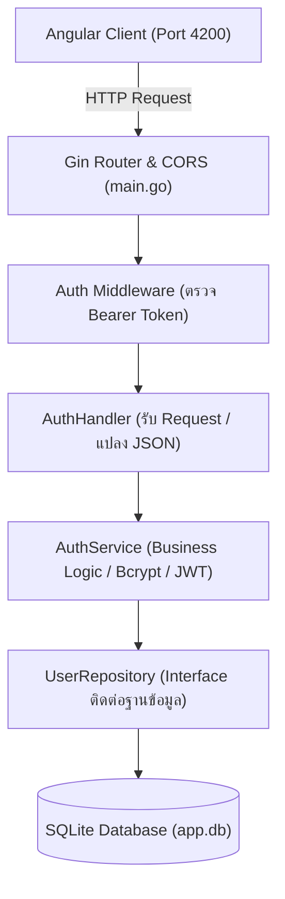

# Fullstack Authentication System (Go + Angular)

ระบบยืนยันตัวตนและจัดการสมาชิกแบบ Fullstack ประกอบด้วย **Backend REST API** ที่พัฒนาด้วยภาษา **Go (Gin + GORM SQLite + JWT)** ตามหลัก Clean Architecture / Layered Pattern และ **Frontend Web Application** ที่พัฒนาด้วย **Angular 18 Standalone Components**

---

## 🏗️ สถาปัตยกรรมของระบบ (System Architecture)

ระบบฝั่ง Backend ถูกออกแบบตามหลัก **Separation of Concerns (SoC)** และ **Dependency Injection (DI)** เพื่อให้โค้ดทดสอบง่าย ดูแลรักษาง่าย และพร้อมต่อยอดในระดับ Enterprise:



---

## 📁 โครงสร้างโปรเจกต์ (Project Structure)

```text
fullstack-no2/
├── .env.example              # ตัวอย่าง Environment Variables
├── .gitignore                # จัดการไฟล์ที่ไม่ต้องการ commit ขึ้น Git
├── go.mod                    # Go Module & Dependencies
├── go.sum                    # Checksums ของ dependencies
├── main.go                   # จุดเริ่มต้นโปรแกรมและประกอบ Dependencies (Wiring)
├── main_test.go              # Automated Integration Tests ครอบคลุม 100%
│
├── config/
│   └── config.go             # จัดการ Environment Variables พร้อมค่า Default
├── database/
│   └── database.go           # การเชื่อมต่อ SQLite และ Auto-migration
├── models/
│   ├── user.go               # Entity โครงสร้างตาราง User
│   └── dto.go                # Data Transfer Objects (Request / Response)
├── repository/
│   └── user_repository.go    # Data Access Layer (ติดต่อฐานข้อมูลผ่าน GORM)
├── services/
│   └── auth_service.go       # Business Logic (Hashing, Check Duplicate, Token)
├── handlers/
│   └── auth.go               # Presentation Layer (HTTP Handler / Controller)
├── middleware/
│   ├── auth.go               # ดักจับ Header 'Authorization: Bearer <token>'
│   └── cors.go               # ตั้งค่า CORS อนุญาต Origin http://localhost:4200
├── utils/
│   └── jwt.go                # เครื่องมือสร้างและตรวจสอบ JWT Token (อายุ 2 ชม.)
│
└── frontend/                 # Angular 18 Standalone Project
    ├── src/
    │   ├── app/
    │   │   ├── components/
    │   │   │   ├── login/       # Form IT 02-1 (/login)
    │   │   │   ├── register/    # Form IT 02-2 (/register)
    │   │   │   └── dashboard/   # Form IT 02-3 (/dashboard)
    │   │   ├── services/
    │   │   │   └── auth.service.ts
    │   │   ├── app.routes.ts
    │   │   └── app.config.ts
    │   └── styles.css
    ├── angular.json
    └── package.json
```

---

## 🚀 วิธีการติดตั้งและรันระบบ

### 1. ฝั่ง Backend (Golang)
```bash
# ดาวน์โหลดและจัดระเบียบ Go packages
go mod tidy

# รันเซิร์ฟเวอร์ที่ Port 8080
go run main.go

# (ทางเลือก) รันชุดทดสอบ Integration Tests
go test -v ./...
```

### 2. ฝั่ง Frontend (Angular)
เปิด Terminal แท็บใหม่แล้วเข้าไปที่โฟลเดอร์ `frontend`:
```bash
cd frontend

# ติดตั้ง dependencies
npm install

# รัน Angular Dev Server ที่ Port 4200
npm start
# หรือ ng serve --port 4200
```

เปิดบราวเซอร์ไปที่: **`http://localhost:4200`**

---

## 📡 รายละเอียด API Endpoints

| Method | Endpoint | สิทธิ์เข้าถึง | คำอธิบาย |
| :--- | :--- | :--- | :--- |
| `POST` | `/api/register` | Public | สมัครสมาชิก (ตรวจ Password ตรงกัน, Hash ด้วย Bcrypt, เช็ค Username ซ้ำ) |
| `POST` | `/api/login` | Public | ลงชื่อเข้าใช้ (ตรวจ Password เทียบ Hash และส่งกลับ JWT Token อายุ 2 ชม.) |
| `GET` | `/api/profile` | Protected | ดูข้อมูลส่วนตัว (ต้องส่ง Header `Authorization: Bearer <token>`) |

---

## 🔍 วิธีการดูข้อมูลในฐานข้อมูล SQLite

ฐานข้อมูลจะถูกเก็บเป็นไฟล์เดียวชื่อ **`app.db`** ในโฟลเดอร์ root:

```bash
# ดูตาราง Users ผ่าน Terminal
sqlite3 -header -column app.db "SELECT id, username, password, created_at FROM users;"
```
*(รหัสผ่านจะถูกบันทึกเป็น Bcrypt Hash `$2a$10$...` เพื่อความปลอดภัย)*
